# FlowDesk — Full-Stack Team Productivity Platform

FlowDesk is a production-style, full-stack application built around a fictional team-productivity product. It has three parts:

1. **Marketing site:** landing page, pricing with an ROI calculator, a blog backed by a live REST API, and a contact form.
2. **Workspace app (`/app`):** a multi-tenant project-management product. It includes a Kanban board, calendar, dependency graph with critical path, workflow automations, approvals, real-time collaboration, an AI assistant, analytics, audit log with restore, background jobs, webhooks and offline mode.
3. **Backend API (`/server`):** Node.js + Express + PostgreSQL + JWT, with a job queue, signed webhooks, WebSockets and an OpenAPI spec.

The business rules (dependency graph, automation engine, approval state machine, permissions, analytics, AI planner, merge logic) live **once** in `/shared` and run in both the browser and the server.

> **Stack:** React 19 · JavaScript (ES2022) · plain CSS · React Router · Vite · Node.js · Express 5 · PostgreSQL · JWT · WebSockets · zod · Vitest + Testing Library + axe-core + supertest · oxlint · Prettier · GitHub Actions · Docker

**Two ways to run the workspace:**

| Mode                    | What runs                               | Use it for                                                        |
| ----------------------- | --------------------------------------- | ----------------------------------------------------------------- |
| **Demo mode** (default) | The whole workspace runs in the browser | Reviewers: open `/app`, pick a demo user, no setup                |
| **API mode**            | React app ↔ Express API ↔ PostgreSQL    | The real architecture: `VITE_WORKSPACE_API_URL` points to the API |

---

## Contents

- [Why I built this](#why-i-built-this)
- [Screenshots](#screenshots)
- [Features](#features)
- [Workspace app features](#workspace-app-features)
- [Backend API](#backend-api)
- [Quick start](#quick-start)
- [Scripts](#scripts)
- [Project structure](#project-structure)
- [Architecture](#architecture)
- [State management](#state-management)
- [Data fetching & API layer](#data-fetching--api-layer)
- [Performance](#performance)
- [Accessibility](#accessibility)
- [Security](#security)
- [Testing](#testing)
- [SEO](#seo)
- [Deployment](#deployment)
- [Configuration](#configuration)
- [Extending the project](#extending-the-project)
- [Future improvements](#future-improvements)
- [Further documentation](#further-documentation)

---

## Why I built this

I built FlowDesk as the take-home project for a **Senior Software Engineer** application. The brief asked for a landing page. I wanted it to show the things a senior engineer is trusted with beyond the visuals:

- **Architecture that scales**: a feature-based structure with clear boundaries, so a team can work on it in parallel.
- **Real product behaviour**: an interactive board, live API data and forms with proper validation, with every loading, empty and error state handled.
- **Quality you can verify**: automated tests (including accessibility audits), linting, a CI pipeline and documented decisions.
- **Production readiness**: security headers, performance budgets, Docker and multiple deployment targets.
- **Real systems design**: multi-tenancy, permissions, transactions, a job queue with retries and a dead-letter queue, signed webhooks, real-time sync and conflict resolution. These are the problems a senior engineer is hired to solve, so the project includes a real backend that solves them.

## Screenshots

| Home (light)                                       | Live Kanban demo                                                |
| -------------------------------------------------- | --------------------------------------------------------------- |
| 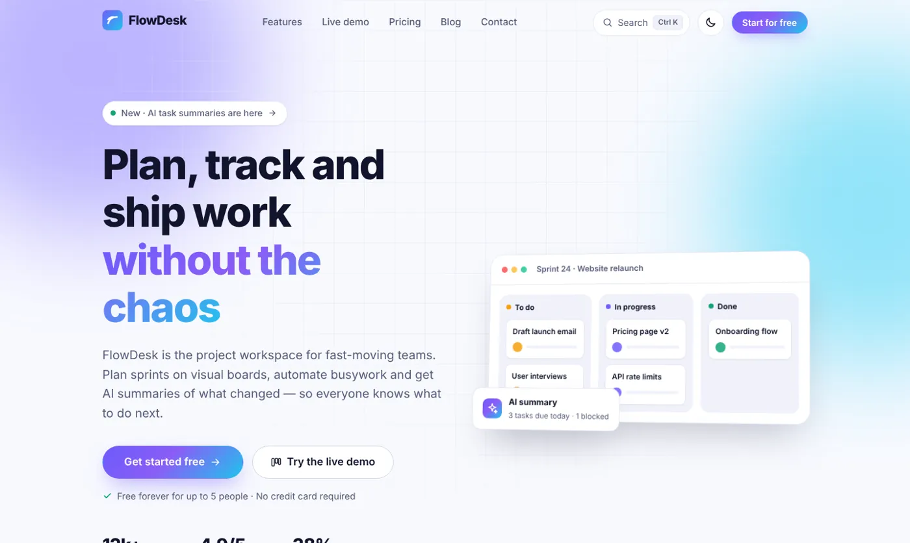 | 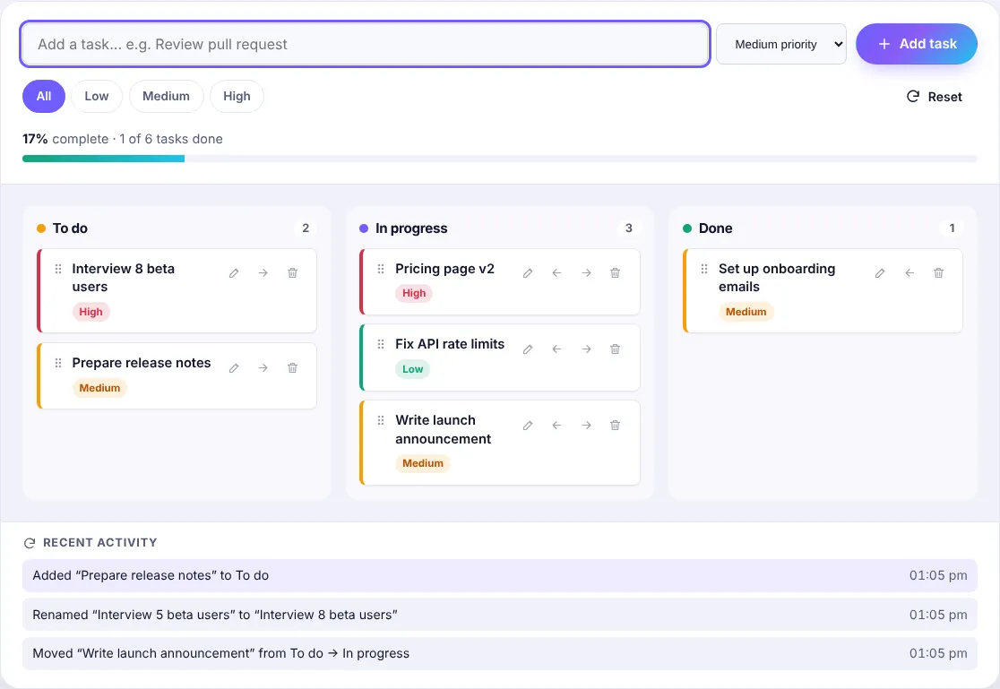 |

| ROI calculator (dark)                             | Blog with filters (dark)                      |
| ------------------------------------------------- | --------------------------------------------- |
| 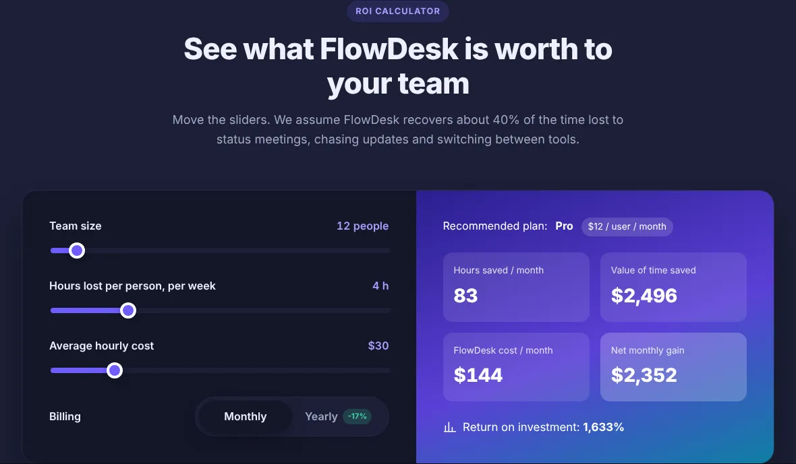 | 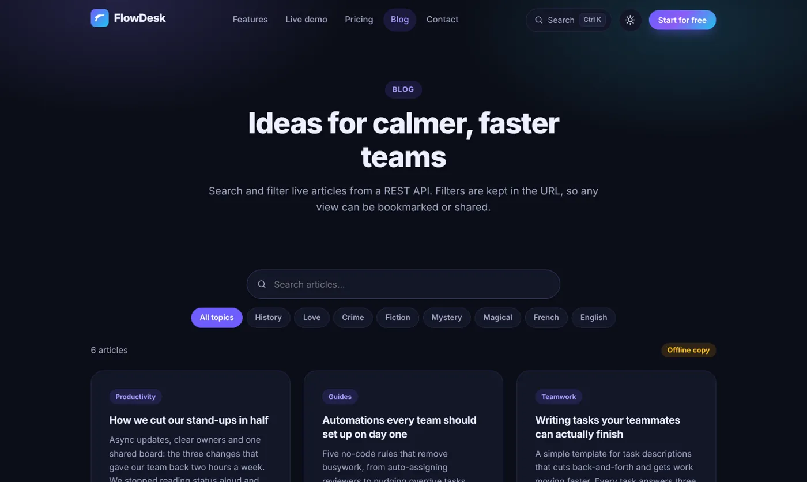 |

### Workspace app (`/app`)

| Dashboard                                                  | Board with blocked tasks and approvals             |
| ---------------------------------------------------------- | -------------------------------------------------- |
| 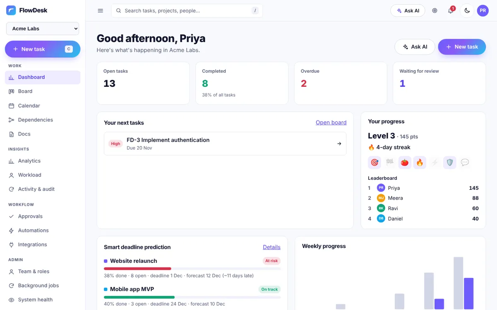 | 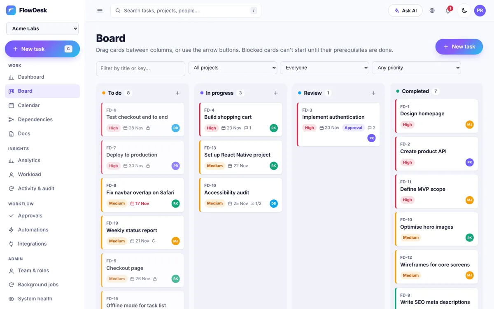 |

| Dependency graph + critical path                           | AI assistant                                        |
| ---------------------------------------------------------- | --------------------------------------------------- |
| 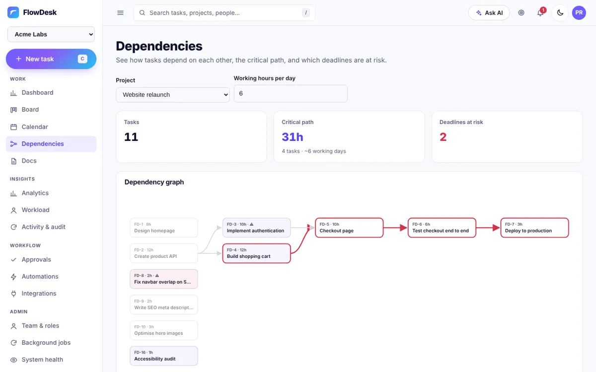 | 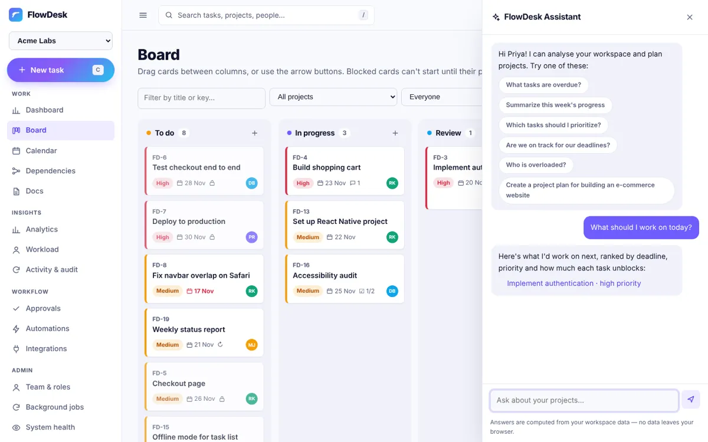 |

| Analytics                                        | Automations                                          | Background jobs                        |
| ------------------------------------------------ | ---------------------------------------------------- | -------------------------------------- |
| 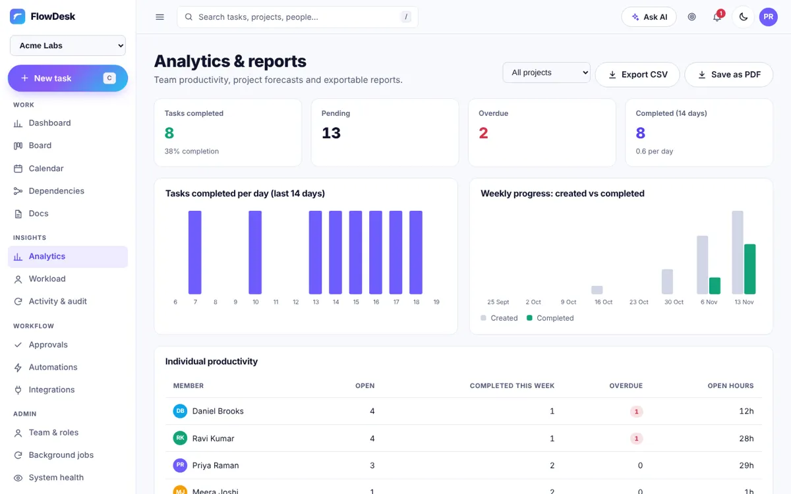 | 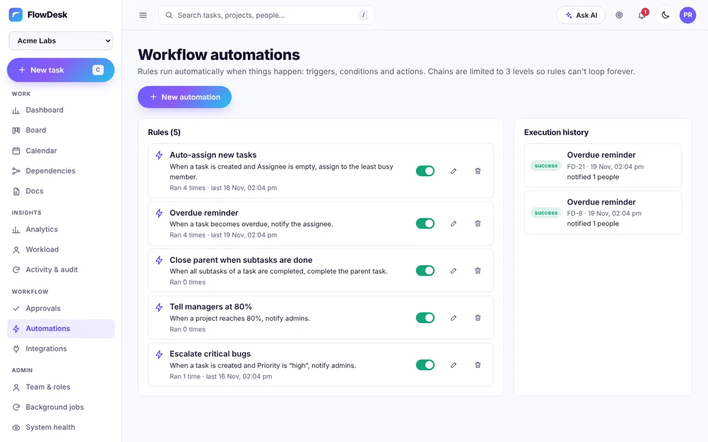 | 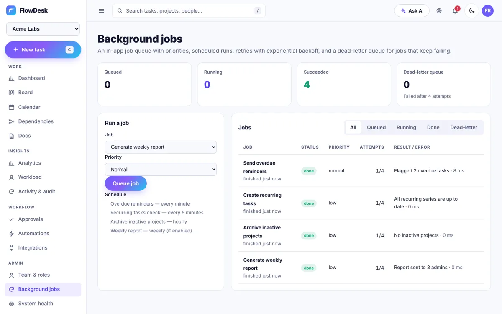 |

| Calendar                                       | Mobile                                           |
| ---------------------------------------------- | ------------------------------------------------ |
| 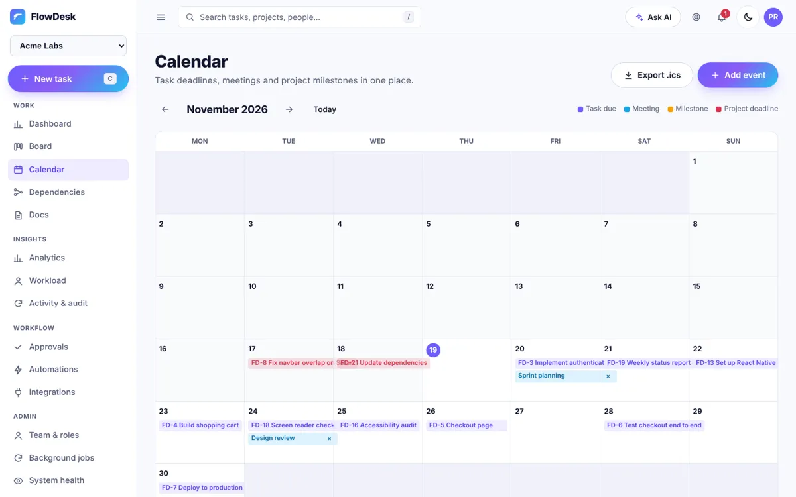 | 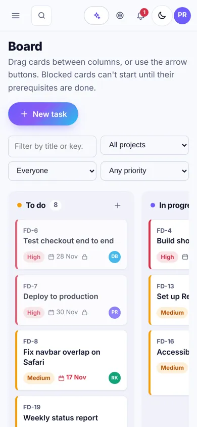 |

### Marketing site

| Contact form validation                               | ⌘K command menu                                     | Mobile                                            |
| ----------------------------------------------------- | --------------------------------------------------- | ------------------------------------------------- |
| 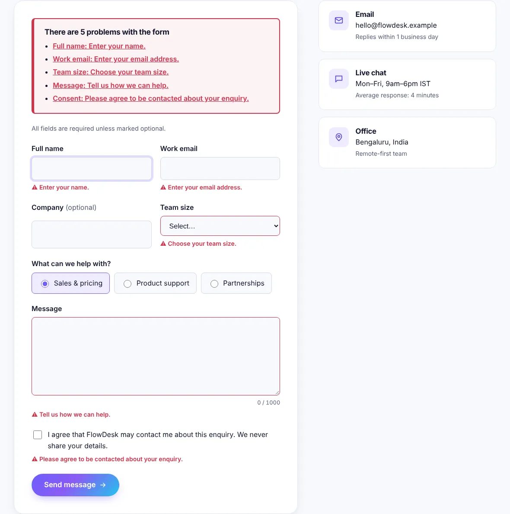 | 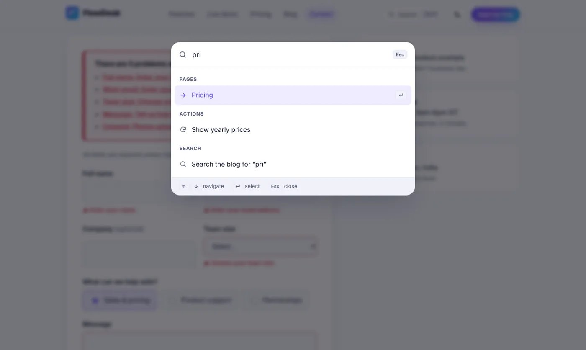 | 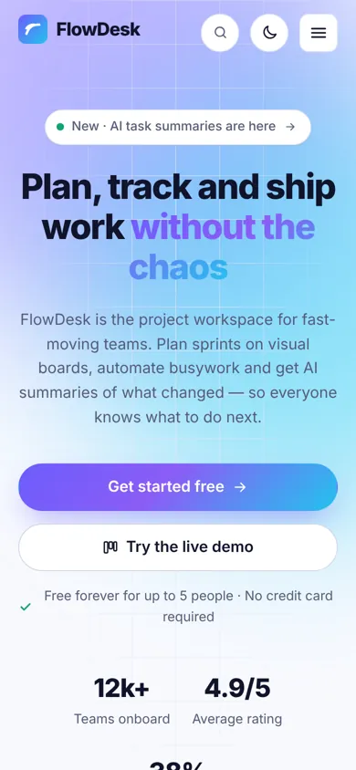 |

## Features

| Area                 | What you can do                                                                                                                                                           |
| -------------------- | ------------------------------------------------------------------------------------------------------------------------------------------------------------------------- |
| **Home page**        | Animated hero, feature grid, how-it-works, pricing, testimonials, latest posts, FAQ, newsletter                                                                           |
| **Live Kanban demo** | Add, delete, filter and drag tasks between columns, or move them with keyboard buttons. Progress bar, and the board is saved in `localStorage`                            |
| **Pricing page**     | Monthly/yearly toggle shared across the app, **ROI calculator** with sliders and plan recommendation, accessible **comparison table**                                     |
| **Blog**             | Live posts from a REST API with **debounced search**, **tag filters**, **pagination**, URL-synced filters, skeleton loaders, empty and error states, **offline fallback** |
| **Article page**     | Post, author and comments fetched **in parallel**; breadcrumbs; prefetched on hover for instant navigation                                                                |
| **Contact page**     | Multi-field form with validate-on-blur, an **error summary**, character counter, honeypot + timing bot protection, success state                                          |
| **Command menu**     | `Ctrl/⌘ + K` to jump to any page, toggle theme, switch billing or search the blog. Full keyboard support                                                                  |
| **Global UX**        | Dark/light theme (system default, persisted, no flash), toast notifications, back-to-top, 404 page, error boundaries, route loading bar                                   |

## Workspace app features

Open `/app` and sign in as any demo user (Owner, Admin, Member or Viewer) to see how permissions change the UI. Open it in **two browser tabs as two different users** to see real-time collaboration.

| Area                        | Features                                                                                                                                                                                                                                                                                                                                                                                                                                                                                                                                                                                                    |
| --------------------------- | ----------------------------------------------------------------------------------------------------------------------------------------------------------------------------------------------------------------------------------------------------------------------------------------------------------------------------------------------------------------------------------------------------------------------------------------------------------------------------------------------------------------------------------------------------------------------------------------------------------- |
| **Project management**      | Kanban (To do / In progress / Review / Completed) with drag and drop and keyboard moves · calendar (month view, events, `.ics` export) · task dependencies · recurring tasks (daily/weekly/monthly) · subtasks · file attachments · custom fields with dynamic forms                                                                                                                                                                                                                                                                                                                                        |
| **Dependency graph**        | Visual graph by level · **cycle detection** (a dependency that would create a loop is rejected) · **critical path** · **deadline impact** (which tasks slip if one is late) · blocked tasks can't start                                                                                                                                                                                                                                                                                                                                                                                                     |
| **Workflow automation**     | "When X happens, if Y, then do Z" rules that connect tasks, approvals, notifications and deadlines (e.g. _when an approval is rejected → move the task back to In progress and notify the assignee_; _when a task is due within 24 hours → remind the assignee_) · run history · loop protection (max depth 3)                                                                                                                                                                                                                                                                                              |
| **Approval workflow**       | Configurable chain (e.g. Admin → Owner) · approve / reject with reason · tasks can't complete until approved                                                                                                                                                                                                                                                                                                                                                                                                                                                                                                |
| **Multi-tenancy & roles**   | Organisations with isolated data · switch org · roles Owner / Admin / Member / Viewer enforced on every action · invitations                                                                                                                                                                                                                                                                                                                                                                                                                                                                                |
| **Real-time collaboration** | Live updates across tabs/users · presence (who's online and what they're viewing) · live cursors and editing in shared docs · **three-way merge** of concurrent edits                                                                                                                                                                                                                                                                                                                                                                                                                                       |
| **Collaboration**           | Comments with **@mentions** and attachments · activity timeline · team announcements · smart notifications (assigned, mentioned, due soon, overdue, approvals)                                                                                                                                                                                                                                                                                                                                                                                                                                              |
| **AI**                      | AI assistant grounded in workspace data ("What's overdue?", "Who is overloaded?", "Are we on track?") · **AI task generator** (turns "Build an e-commerce website" into a dependent task plan) · **smart deadline prediction** from team velocity                                                                                                                                                                                                                                                                                                                                                           |
| **Insights**                | Productivity analytics (completed per day, weekly progress, by priority/project) · workload management with capacity and overload warnings · observability dashboard (API latency, error rate, slowest calls, job queue health)                                                                                                                                                                                                                                                                                                                                                                             |
| **Integrations**            | **GitHub**: connects to a real repository through the GitHub REST API, links pull requests and commits to tasks by key (e.g. `FD-4` in a PR title, branch or commit), shows PR status (open / draft / merged / closed) and moves tasks by configurable rules (PR opened → Review, merged → Completed); syncs every 10 minutes or on demand, plus an optional signed webhook for instant updates · **Slack**: connecting posts a real test message, then completions and approval decisions are posted · outgoing **webhooks signed with HMAC-SHA256** · Google Calendar/Outlook (iCal feed) · email digests |
| **Audit & change history**  | Every change records who, what, when and the **previous and new value** of each field · one-click **restore** of the previous version · GitHub, automations and the scheduler appear as their own actors                                                                                                                                                                                                                                                                                                                                                                                                    |
| **Reliability**             | **Background jobs** with priorities, scheduling, retries with exponential backoff and a **dead-letter queue** · **audit log** of every change with before/after and **one-click restore** · doc version history                                                                                                                                                                                                                                                                                                                                                                                             |
| **Offline**                 | Works offline; changes made offline are queued and **synced with conflict detection** when you reconnect · service worker caches the app shell                                                                                                                                                                                                                                                                                                                                                                                                                                                              |
| **Search**                  | Global search across tasks, docs and people with filters and highlighted matches · **saved searches**                                                                                                                                                                                                                                                                                                                                                                                                                                                                                                       |
| **Productivity**            | Focus mode with **Pomodoro timer** · **gamification** (points, streaks, badges) · keyboard shortcuts (`?` lists them) · export to **CSV and PDF** · dark/light mode                                                                                                                                                                                                                                                                                                                                                                                                                                         |

## Backend API

The `/server` folder is a separate Node.js app that implements the same workspace as a real multi-user service.

| Concern            | Implementation                                                                                                                                                                                                                                                                                         |
| ------------------ | ------------------------------------------------------------------------------------------------------------------------------------------------------------------------------------------------------------------------------------------------------------------------------------------------------ |
| **Auth**           | Register/login with **bcrypt** (cost 12) · short-lived **JWT access tokens** (15 min) · **rotating refresh tokens** stored hashed, with **reuse detection** (a stolen, already-used token revokes the whole session family) · login rate limit · constant-time compare                                 |
| **Multi-tenancy**  | Every query is scoped by `org_id` · non-members get **404, not 403** (no leaking that an org exists) · role checks via the shared `can()` permission table                                                                                                                                             |
| **Validation**     | Every request body is validated with **zod** · consistent JSON error format                                                                                                                                                                                                                            |
| **Data integrity** | Writes go through a **unit of work** (`withWrite`): one transaction covers the change, the audit log entry and notifications, and events are only published **after commit** · optimistic concurrency with `version` (409 on conflict)                                                                 |
| **Job queue**      | Jobs table in PostgreSQL · workers claim jobs with an **atomic conditional UPDATE**, so two workers never run the same job · priorities, `run_at` scheduling, retries with backoff, dead-letter queue, manual retry                                                                                    |
| **Webhooks**       | Real HTTP delivery signed with HMAC-SHA256 · **SSRF protection** (private/loopback IPs are blocked after DNS lookup, redirects are not followed) · delivery log                                                                                                                                        |
| **Integrations**   | GitHub REST API client (repository check on connect, PR + commit sync on a schedule) · GitHub tokens **encrypted at rest** (AES-256-GCM) and never returned to the browser · Slack URL hidden from non-admins · **signed GitHub webhook receiver** (`X-Hub-Signature-256`) · token-protected iCal feed |
| **Real time**      | WebSocket server, one room per org; clients authenticate with their JWT; events and presence are pushed live                                                                                                                                                                                           |
| **Offline sync**   | `POST /orgs/:id/sync` applies queued offline changes with a **field-level merge** and reports conflicts                                                                                                                                                                                                |
| **AI**             | Built-in grounded assistant (no key needed); if `ANTHROPIC_API_KEY` is set, answers are polished by an LLM using only the computed facts                                                                                                                                                               |
| **Ops**            | helmet security headers · CORS allow-list · rate limiting · structured JSON logs · `/health` (checks DB) · `/metrics` (protected) · graceful shutdown · server refuses to start in production with a weak `JWT_SECRET`                                                                                 |
| **Docs**           | OpenAPI 3 spec in [`server/openapi.yaml`](server/openapi.yaml) (34 paths)                                                                                                                                                                                                                              |

**Database:** 22 tables in [`server/src/db/schema.sql`](server/src/db/schema.sql):

```
users ─< memberships >─ orgs ─< projects ─< tasks ─< comments
                         │                    │
                         ├─< invitations      ├─ blocked_by (task ids)  ─ dependency graph
                         ├─< automation_rules ─< automation_runs
                         ├─< webhooks ─< webhook_deliveries
                         ├─< jobs                (queue: status, priority, run_at, attempts)
                         ├─< audit_logs          (before/after JSON for every change)
                         ├─< docs ─< doc_versions
                         ├─< events, field_defs, notifications, saved_searches, user_stats
users ─< refresh_tokens   (hashed, family id for reuse detection)
```

## Quick start

Requires **Node.js 20+**.

### 1. Frontend only (demo mode, no database needed)

```bash
npm install
npm run dev               # http://localhost:5173  → open /app for the workspace
```

### 2. Frontend + backend (API mode)

No PostgreSQL installed? The server can run on an **in-memory PostgreSQL** with demo data:

```bash
# Terminal 1 – API
cd server
npm install
npm run dev:memory        # http://localhost:4000/api  (data resets on restart)

# Terminal 2 – web app
#   create a file called .env in the project root containing:
#   VITE_WORKSPACE_API_URL=http://localhost:4000/api
npm run dev
```

Demo logins (password `demo1234`): `priya@acme.test` (Owner), `daniel@acme.test` (Admin), `ravi@acme.test` (Member), `sara@acme.test` (Viewer).

With your own PostgreSQL: copy `server/.env.example` to `server/.env`, set `DATABASE_URL`, then run `npm run seed` and `npm run dev` inside `server/`.

### 3. Everything in Docker (PostgreSQL + API + web)

```bash
docker compose up --build
# Web → http://localhost:8080   API → http://localhost:4000/api
```

## Scripts

| Command                           | Description                                                  |
| --------------------------------- | ------------------------------------------------------------ |
| `npm run dev`                     | Start the dev server with hot reload                         |
| `npm run build`                   | Production build into `dist/`                                |
| `npm run build:hash`              | Build with hash routing (for GitHub Pages)                   |
| `npm run preview`                 | Serve the production build locally                           |
| `npm test`                        | Run all tests once                                           |
| `npm run test:watch`              | Run tests in watch mode                                      |
| `npm run coverage`                | Tests + coverage report (fails under 75%)                    |
| `npm run lint`                    | Lint with oxlint (React, hooks, a11y, imports, Vitest rules) |
| `npm run format` / `format:check` | Format with / check against Prettier                         |
| `npm run check`                   | **Everything CI runs**: lint → format → test → build         |
| `cd server && npm test`           | API tests (Express + in-memory PostgreSQL)                   |
| `cd server && npm run dev:memory` | Start the API with an in-memory database                     |

## Project structure

The code is organised **by feature** rather than by file type, so everything about one feature lives together and can be changed or removed as a unit.

```
src/
├── app/                    # Application shell
│   ├── router.jsx          #   Route table + router factory (browser / hash / memory)
│   ├── AppLayout.jsx       #   Navbar, <Outlet/>, footer, toasts, command menu, error boundary
│   ├── RouteEffects.jsx    #   Scroll, focus & screen-reader announcements on navigation
│   └── ThemeSync.jsx       #   Mirrors theme state to <html data-theme>
├── pages/                  # One component per route (thin: compose features)
├── features/               # Self-contained product features
│   ├── board/              #   Kanban demo: store, reducer, columns, cards, tests
│   ├── blog/               #   API service, fallback data, cards, filters, tests
│   ├── pricing/            #   Pure pricing maths, cards, ROI calculator, comparison table
│   ├── contact/            #   Form schema, service (bot protection), form UI
│   ├── command-palette/    #   Command definitions + accessible combobox dialog
│   ├── marketing/          #   Hero, features, testimonials, FAQ…
│   └── newsletter/
├── components/
│   ├── ui/                 # Generic, reusable building blocks (Button, Card, FormField, Pagination…)
│   ├── layout/             # Navbar, Footer
│   └── ErrorBoundary.jsx
├── hooks/                  # useQuery, useForm, useDebounce, useHotkey, useFocusTrap, useInView…
├── lib/                    # Framework-agnostic core: store, http client, query cache, validators
├── store/                  # Global app store (theme, billing, toasts, command menu)
├── config/env.js           # Validated environment configuration
├── data/content.js         # All marketing copy, kept separate from components
├── styles/                 # Design tokens (CSS variables) + global styles
└── test/                   # Test setup, helpers and accessibility suite
```

```
shared/                     # Pure domain logic used by BOTH the browser and the server
├── graph.js                #   Cycle detection, topological sort, critical path, deadline impact
├── automation.js           #   Rule engine (triggers → conditions → actions, loop protection)
├── approvals.js            #   Approval state machine
├── permissions.js          #   Role → permission table (can, canChangeRole)
├── analytics.js            #   Summaries, velocity, workload, deadline prediction
├── assistant.js            #   AI intents, prioritisation, plan generator
├── merge.js                #   Three-way text merge + field-level record merge
└── jobs.js, recurrence.js, search.js, gamification.js, csv.js, ics.js, integrations.js …

src/workspace/              # The /app product
├── engine/                 #   Demo mode: in-browser engine (DB, auth, permissions, jobs, realtime across tabs)
├── remote/                 #   API mode: same interface, backed by REST + WebSocket + offline outbox
├── pages/                  #   Dashboard, Board, Calendar, Dependencies, Docs, Analytics, Workload…
├── overlays/               #   Task drawer, AI assistant, search, notifications, focus mode
└── WorkspaceRoot.jsx       #   Shell: sidebar, top bar, shortcuts, presence

server/
├── src/routes/             # auth, orgs, tasks, workspace (bootstrap, docs, ai, jobs, sync…), public (GitHub, iCal)
├── src/services/           # withWrite (unit of work), tasks, automations, queue, worker, webhooks, realtime, llm
├── src/middleware/         # requireAuth, requireMembership, authorize, validate, metrics
├── src/db/                 # schema.sql, migrate, seed, pool
├── tests/                  # API tests with supertest + pg-mem
└── openapi.yaml
```

Every component keeps its CSS file next to it. Imports use the `@/` alias (`@/lib/http`) instead of fragile `../../` paths.

## Architecture

```
            ┌─────────────────────────── app/ ───────────────────────────┐
            │ router → AppLayout (ErrorBoundary + Suspense) → pages/     │
            └───────────────────────────────┬────────────────────────────┘
                                            ▼
     pages/ (thin)  ──compose──▶  features/ (UI + feature logic)  ──use──▶  components/ui (generic)
                                            │
                     ┌──────────────────────┼───────────────────────┐
                     ▼                      ▼                       ▼
              hooks/useQuery         store/ (createStore)       services (per feature)
                     │                      │                       │
                     ▼                      ▼                       ▼
             lib/queryCache          lib/createStore             lib/http  ──▶  REST API
```

**Dependency rules**

1. `lib/` has no React UI and doesn't depend on features, so it could be published as a package.
2. `components/ui` know nothing about the business; they're configured only through props.
3. Features talk to the network only through their `*Service.js` file, never `fetch()` directly.
4. Business logic (pricing maths, validation, reducers, command filtering) is **pure functions**, unit-tested without rendering anything.
5. Pages are thin: they set SEO metadata and compose features.

**Full-stack view**

```
 Browser                                               Server (Node.js)
 ┌──────────────────────────────┐   REST (JWT)    ┌───────────────────────────────────┐
 │ React UI (/app pages)        │ ──────────────▶ │ Express routes → zod validation   │
 │        │ same api contract   │                 │   → requireAuth → requireMembership│
 │        ▼                     │   WebSocket     │   → authorize (shared/permissions)│
 │ engine/ (demo) or remote/    │ ◀────────────── │   → withWrite: TX + audit + notify│
 │ (API mode + offline outbox)  │   live events   │        │ after commit             │
 └──────────────┬───────────────┘                 │        ▼                          │
                │                                 │   Event bus → automations         │
                └──── shared/ domain logic ───────│            → webhooks (job queue) │
                                                  │            → WebSocket rooms      │
                                                  │   Worker: claims jobs, retries,   │
                                                  │           dead-letter queue       │
                                                  └───────────────┬───────────────────┘
                                                                  ▼
                                                             PostgreSQL
```

A deeper write-up, including data-flow diagrams, is in [`docs/ARCHITECTURE.md`](docs/ARCHITECTURE.md).

## State management

| State                                       | Where it lives                                 | Why                                                                  |
| ------------------------------------------- | ---------------------------------------------- | -------------------------------------------------------------------- |
| Theme, billing period, toasts, command menu | `store/appStore.js` (global store)             | Shared across unrelated parts of the app                             |
| Kanban board                                | `features/board/boardStore.js` (feature store) | Complex updates; persisted; only the board needs it                  |
| Server data (posts, articles)               | `lib/queryCache.js` via `useQuery`             | Server state has different needs: caching, staleness, de-duplication |
| Blog filters & page                         | The **URL** (`?q=&tag=&page=`)                 | Shareable, bookmarkable, survives refresh, back button works         |
| Form values & errors                        | `useForm` (local)                              | Belongs to one form only                                             |

The global store is a ~60-line **`useSyncExternalStore`** implementation (`lib/createStore.js`), similar to Zustand. Components subscribe with **selectors** and re-render only when their slice changes. That's the main advantage over a single React Context, which re-renders every consumer on any change. A test proves it (`createStore.test.js`).

The board state is **normalised** (`tasks` by id + `columns` as id arrays). Moving a card re-renders only the two affected columns, and each memoised card re-renders only when its own task changes.

## Data fetching & API layer

- **`lib/http.js`**: a `fetch` wrapper with base URL, JSON handling, an **8s timeout**, **cancellation**, and **retry with exponential backoff**. It retries only network errors, 429 and 5xx, never 4xx, and never non-idempotent POSTs.
- **`lib/queryCache.js` + `hooks/useQuery.js`**: an observable cache (in the style of TanStack Query) with **stale time**, **request de-duplication**, **prefetching**, `keepPreviousData` for smooth pagination, and per-key storage, so responses arriving out of order can't show the wrong page.
- **`features/blog/blogService.js`**: maps API responses to UI shapes. If the network is unreachable it **falls back to bundled posts**, while real server errors are still surfaced to the user.

API: [DummyJSON](https://dummyjson.com) (free, no key needed).

## Performance

- **Route-level code splitting**: each page is its own chunk. Below-the-fold home sections and the command menu are lazy-loaded too.
- **Long-lived vendor chunk**: React and the router are split from app code, so a deploy doesn't invalidate the cached vendor bundle.
- **Fewer re-renders**: selector-based subscriptions, `memo` on list items, stable callbacks, normalised state, and reducers that return the same object for no-op updates.
- **Network**: cache + de-duplication, debounced search (one request instead of one per keystroke), hover/focus **prefetch** of articles.
- **No heavy assets**: inline SVG icons, a CSS-drawn hero, no raster images, and fonts with `preconnect` + `display=swap`.
- **Smooth animations**: animations use `transform`/`opacity` only and `IntersectionObserver` instead of scroll listeners. The scroll listener is rAF-throttled and passive.
- **Monitoring**: Core Web Vitals (LCP, INP, CLS…) are reported via `web-vitals`, loaded lazily (`lib/monitoring.js`).

Initial JS: **~12 kB** app code + **~100 kB** vendor (gzipped).

## Accessibility

Target: **WCAG 2.1 AA**.

- Semantic landmarks, one `<h1>` per page, a logical heading order, and a skip link
- **Route changes move focus to the new `<h1>` and are announced** to screen readers (SPAs don't do this by default)
- Every interactive feature works by keyboard. Drag and drop has **button alternatives**, and the command menu follows the WAI-ARIA **combobox/listbox** pattern with a focus trap
- Forms: real `<label>`s, `aria-invalid` and `aria-describedby` errors, an **error summary** linking to fields, and focus moved to the first error
- Live regions for toasts, board changes, result counts and loading states
- Visible focus rings, `prefers-reduced-motion` respected, AA contrast in both themes
- **Automated axe-core audits** run in the test suite (`src/test/a11y.test.jsx`). They caught a real duplicate-landmark bug during development

## Security

- **Content Security Policy** and hardening headers (`nosniff`, `X-Frame-Options: DENY`, `Referrer-Policy`, `Permissions-Policy`, HSTS) are set in `vercel.json`, `netlify.toml` and `nginx.conf`
- **No inline scripts.** The theme bootstrap is an external file, so the CSP needs no `'unsafe-inline'`
- **XSS-safe rendering.** All content, including API data, renders through JSX escaping, and `dangerouslySetInnerHTML` is never used
- **Input handling.** Client-side validation, length limits, trimming and normalising before sending, URL-encoding of search terms, and **allow-listed route params** (`/blog/<script>` never reaches the API)
- Values read from `localStorage` are validated, versioned and wrapped in `try/catch`
- **Bot protection** on forms: honeypot field and minimum fill time
- No secrets in the frontend (only `VITE_*` variables, documented in `.env.example`), and `.env` is git-ignored
- The Docker image runs **nginx as a non-root user**, and CI runs `npm audit` on production dependencies

## Testing

**209 automated tests**: 177 frontend + shared-logic tests and 32 API tests. CI fails if frontend coverage drops below 75%.

| Layer                 | Examples                                                                                                                                                        |
| --------------------- | --------------------------------------------------------------------------------------------------------------------------------------------------------------- |
| **Unit** (pure logic) | Pricing/ROI maths, validators, pagination, board reducer, command filtering, blog mapping                                                                       |
| **Core libs**         | Store selectors and persistence, HTTP retry/backoff/abort, cache de-duplication and staleness                                                                   |
| **Hooks**             | `useQuery` (loading → success/error, refetch, keep-previous-data), `useDebounce`                                                                                |
| **Components**        | Board demo, contact form (error summary, focus, submit, failure), command menu (keyboard), pricing toggle, accordion                                            |
| **Integration**       | The full app with real routes: navigation, 404, Ctrl+K, dark mode, blog pagination/filters/debounced search, article page, malformed IDs                        |
| **Accessibility**     | axe-core audits of the pricing page, contact page (including its error state) and the board                                                                     |
| **Domain logic**      | Graph (cycles, critical path), automation engine, approvals, permissions, analytics, AI planner, three-way merge, jobs, CSV injection                           |
| **Workspace engine**  | Permissions per role, tenant isolation, blocked tasks, automations, approvals, audit restore, job retries and dead-letter, webhooks                             |
| **API** (supertest)   | Auth + refresh rotation and reuse detection, tenant 404s, RBAC, validation, optimistic locking, cycles, queue, SSRF blocking, GitHub signatures, sync conflicts |

Tests use Testing Library and query the way users do (by role and label). Only the network is mocked.

```bash
npm test            # run once
npm run coverage    # with coverage report in /coverage
cd server && npm test   # API tests
```

## SEO

- Per-route `<title>`, meta description and Open Graph tags (`useDocumentMeta`)
- Twitter cards, canonical URL, JSON-LD `SoftwareApplication` structured data
- `robots.txt`, `sitemap.xml` and a web manifest
- Clean URLs (browser router) with SPA rewrites on every host

## Deployment

| Target                   | How                                                                                                                                                                                                              |
| ------------------------ | ---------------------------------------------------------------------------------------------------------------------------------------------------------------------------------------------------------------- |
| **Vercel** (recommended) | Import the repo at vercel.com. `vercel.json` provides the SPA rewrites and security headers                                                                                                                      |
| **Netlify**              | Import the repo. `netlify.toml` provides the same                                                                                                                                                                |
| **GitHub Pages**         | Push to `main` and set _Settings → Pages → Source: GitHub Actions_. The workflow tests and builds with hash routing                                                                                              |
| **Docker**               | `docker build -t flowdesk . && docker run -p 8080:8080 flowdesk`. A multi-stage build runs the tests, then serves the site with non-root nginx                                                                   |
| **Full stack**           | `docker compose up --build` runs PostgreSQL, the API and the web app. For hosting: API on Render/Railway/Fly.io with a managed PostgreSQL (Neon, Supabase), frontend on Vercel with `VITE_WORKSPACE_API_URL` set |

**CI** (`.github/workflows/ci.yml`) runs on every push and PR: lint → format check → tests + coverage gate → `npm audit` → build. A second job runs the API tests, then runs migrations and the seed against a **real PostgreSQL** service container.

## Configuration

All configuration goes through `src/config/env.js`, which validates it and applies defaults:

| Variable                 | Default                        | Purpose                                                           |
| ------------------------ | ------------------------------ | ----------------------------------------------------------------- |
| `VITE_API_BASE_URL`      | `https://dummyjson.com`        | REST API base URL                                                 |
| `VITE_ROUTER_MODE`       | `browser`                      | `browser`, `hash` (GitHub Pages) or `memory` (sandboxed embeds)   |
| `VITE_SITE_URL`          | `https://flowdesk.example.com` | Canonical site URL                                                |
| `VITE_WORKSPACE_API_URL` | _(empty)_                      | Empty = demo mode in the browser; set to the API URL for API mode |

Server variables are documented in [`server/.env.example`](server/.env.example): `DATABASE_URL`, `JWT_SECRET`, `CORS_ORIGINS`, `METRICS_TOKEN`, `ANTHROPIC_API_KEY`, `WORKER_ENABLED`.

## Extending the project

- **New page:** create `pages/NewPage.jsx`, then add one lazy import and one route in `app/router.jsx`.
- **New API resource:** add a `featureService.js` that uses `http()`, then read it with `useQuery(key, fetcher)`. Caching, de-duplication, loading and error states come built in.
- **New global state:** add an action to the reducer in `store/appStore.js` plus a selector.
- **New command in ⌘K:** add one object in `features/command-palette/commands.js`.
- **Rebrand:** edit the tokens in `styles/variables.css`; both themes update everywhere.
- **Real backend / CMS / i18n:** copy and API access are already isolated in `data/content.js` and the services, so swapping them doesn't touch components.

## Future improvements

What I'd build next, roughly in priority order:

1. **TypeScript migration**: start with `/shared`, since it is pure functions with JSDoc types, then the server, then the UI.
2. **End-to-end tests** with Playwright for the critical flows (login, board, approvals, two-user real-time), run in CI against a preview deployment. I already use Playwright scripts locally for visual checks.
3. **Scale the realtime layer**: WebSocket rooms are in-process today; with several API instances, use Redis pub/sub or PostgreSQL `LISTEN/NOTIFY` so events reach every instance.
4. **CRDT-based doc editing** (e.g. Yjs) instead of three-way merge, for character-level real-time co-editing.
5. **Real OAuth integrations** for GitHub, Slack and Google Calendar (today: signed webhooks, Slack-formatted messages and an iCal feed).
6. **File storage** on S3 with signed upload URLs (attachments are metadata + data URLs today).
7. **Observability**: OpenTelemetry tracing, Sentry for errors, Prometheus scraping of `/metrics`.
8. **Server-side rendering / pre-rendering** of marketing pages and **internationalisation** (copy is already isolated in `data/content.js`).

## Further documentation

- [`docs/ARCHITECTURE.md`](docs/ARCHITECTURE.md): layers, data flow, and how a request and a state update travel through the app
- [`docs/DECISIONS.md`](docs/DECISIONS.md): architecture decision records (why a custom store, why no UI library, and so on)
- [`CONTRIBUTING.md`](CONTRIBUTING.md): workflow, conventions and the checklist for a pull request
- [`server/openapi.yaml`](server/openapi.yaml): REST API reference (OpenAPI 3)
- [`CHANGELOG.md`](CHANGELOG.md)
